<a href="https://github.com/VANDANADEVIPAMPANA">
  
</a>

  
  
  
  
  





<a href="https://github.com/VANDANADEVIPAMPANA/Online-event-ticketing-system">
  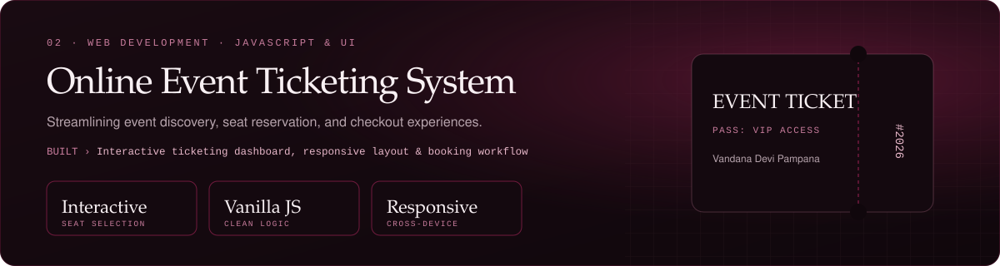
</a>

  

<a href="https://github.com/VANDANADEVIPAMPANA/inventory-and-sales-management-system">
  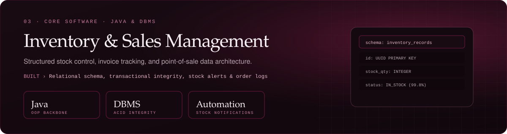
</a>

  

<a href="https://github.com/VANDANADEVIPAMPANA/fakenewsdetectionproject">
  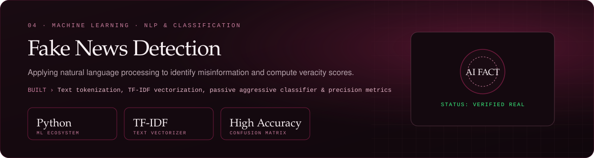
</a>

  


  

  
  
  
  
  

